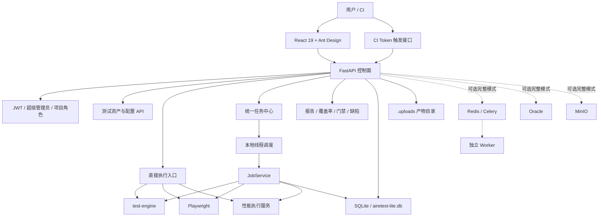
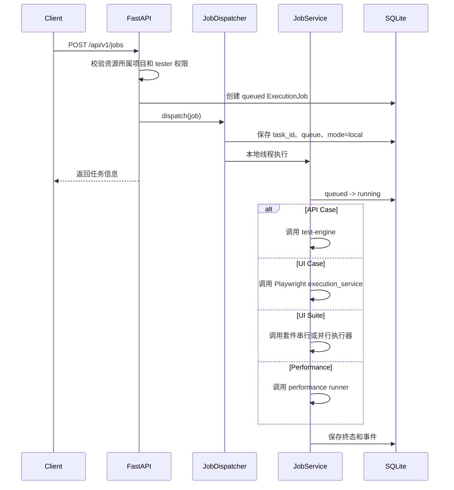

# AIRETEST 平台现状说明

> 文档版本：v1.0
> 编制日期：2026-09-02
> 信息来源：《AIRETEST-当前平台分析与建设路线》《AIRETEST-迭代一开发记录》《AIRETEST-并行开发计划》
> 《AIRETEST-生产化改造与能力扩展开发设计》《AI测试平台-开发任务拆解》《AIRETEST使用手册》及当前工作区代码实际状态
> 文档定位：面向使用者的平台当前功能与工程现状全景

---

## 1. 平台定位与阶段

AIRETEST 已从"接口测试 Demo"演进为覆盖 **API、UI、性能测试、测试资产、报告、权限、CI/CD、通知、知识与 AI 能力**的综合测试平台。

当前所处阶段：

> 个人单机功能型 Beta / 本地可用性验收阶段

判断依据：

- 测试资产与业务功能面完整：后端 42 个路由模块、前端 42 个页面（含登录）。
- 默认 `.env` 已切换为 SQLite、Alembic 和本地线程调度；Oracle、Redis、Celery 与三 Worker 拓扑作为可选完整模式保留。
- API、UI、性能测试均有可工作的直接执行入口。
- 统一任务中心已接入 API、UI 用例、UI 套件与性能测试真实执行，统一保存状态、事件、错误与 Artifact。
- 工作流、契约、质量门禁、缺陷同步已建立数据模型与 API，但核心业务闭环仍为简化实现或未自动触发。

当前最重要的建设目标不是继续增加菜单，而是：

> 保持执行结果真实，并让默认轻量模式可启动、可停止、可检查、可恢复数据。

---

## 2. 当前量化基线

| 项目 | 当前结果 |
|---|---:|
| FastAPI 路由模块 | 42 个，加载失败 0 |
| 前端页面 | 42 个（含登录） |
| ORM 业务表 | 53 张 |
| 默认 SQLite 实际表 | 54 张（含 `alembic_version`） |
| Alembic revision | `a7d9e2c4f610`，共 3 个 |
| 默认运行模式 | SQLite `airetest-lite.db` + 本地线程调度 |
| 默认监听 | 仅 `127.0.0.1:8000`（后端）、`127.0.0.1:5173`（前端） |
| 后端全量测试 | `675 passed, 38 warnings` |
| 前端 typecheck | 通过 |
| 前端 ESLint | 0 errors，740 existing warnings |
| 前端 Vitest | 5 passed |
| 前端 Vite build | 通过，2.43MB chunk warning |
| 默认本地模式 | SQLite + local dispatch，前后端健康 |
| 可选完整模式 | `.env.oracle` + Docker / Oracle / Redis / Celery / MinIO |

---

## 3. 技术栈

| 层 | 技术 |
|---|---|
| 后端 | FastAPI + SQLAlchemy 2.0（declarative）+ Pydantic / Pydantic-Settings + Alembic |
| 前端 | React 19 + TypeScript + Vite + Ant Design v5 + Chart.js / Recharts + Axios |
| API 测试引擎 | 独立 `test-engine` 包（请求构建 / 变量提取 / 断言 / 结果组装） |
| UI 测试 | Playwright（执行 + 录制，可产出截图、Trace、视频） |
| 性能测试 | Locust 场景 + 实时指标 + 服务器本地指标采集 |
| 数据 | SQLite（默认）、Oracle 可选、Redis 可选 |
| 队列/调度 | 本地线程（默认）、Celery/Redis（可选完整模式） |
| 部署 | Docker Compose、可选 Kubernetes、本地 PowerShell 脚本 |

---

## 4. 当前总体架构



### 4.1 五层职责

| 层级 | 职责 |
|---|---|
| 测试资产层 | 项目、环境、变量、接口、用例、计划、UI 元素/步骤/套件、压测场景 |
| 测试执行层 | API 执行、UI Playwright 执行、性能执行、定时任务、统一任务中心 |
| 结果治理层 | 报告、历史、覆盖率、性能指标、视觉回归、JUnit、任务产物 |
| 质量协作层 | 契约、质量门禁、缺陷、通知、CI/CD、审计、用例版本与评审 |
| 智能增强层 | AI 用例生成、失败分析、知识库、AI 调用治理与反馈 |

---

## 5. 核心数据域

| 数据域 | 代表表 |
|---|---|
| 用户与权限 | `users`、`roles`、`user_roles`、`projects`、`project_members` |
| API 测试 | `test_cases`、`assertion_rules`、`test_plans`、`test_plan_items` |
| UI 测试 | `ui_test_cases`、`ui_test_suites`、`ui_elements`、`ui_locators` |
| 性能测试 | `performance_tests`、`performance_results`、`perf_metrics` |
| 任务中心 | `execution_jobs`、`execution_attempts`、`job_events`、`job_artifacts` |
| 质量治理 | `contract_versions`、`quality_gates`、`defect_tickets` |
| 通知集成 | `notification_channels`、`notification_rules`、`webhook_configs` |
| AI 与知识 | `ai_invocations`、`ai_feedback`、`defect_patterns`、`business_rules`、`interface_knowledge` |

---

## 6. 执行链路事实

### 6.1 直接执行能力

| 类型 | 直接执行入口 | 实际实现 |
|---|---|---|
| API | `execution`、测试用例、测试计划等接口 | 调用 `test-engine` 真实发起请求 |
| UI Case | UI 用例运行接口 | 调用 Playwright 真实执行步骤 |
| UI Suite | UI 套件运行接口 | 支持串行或线程池并行执行 |
| Performance | 性能测试运行接口 | 后台线程执行请求和指标采集 |

### 6.2 统一任务中心链路



四类默认 local job 验收结果（均为真实执行，非占位成功）：

| 类型 | Job ID | 状态与证据 |
|---|---|---|
| API Case | `66c5b38b-ae6a-4a18-bc9a-4453f91eaac3` | `succeeded`，5 事件 |
| UI Case | `b616c144-6a52-4364-bb0f-59ff772e690c` | `succeeded`，screenshot + trace |
| UI Suite | `12d00a7e-3ee3-4eb0-b909-90fba591263c` | `succeeded`，screenshot + report |
| Performance | `dd3c4bb6-5c05-4db1-ad1b-a84d96ee81a2` | `succeeded`，3 requests/3 success，report |

### 6.3 取消与超时

- queued/running 状态可请求取消；任务有幂等键、尝试次数、事件和终态约束。
- 执行器只允许返回 `succeeded`、`failed` 或 `timed_out`。
- 明确限制：API 进程重启会中断进程内运行任务；local 线程无分布式租赁恢复；WebSocket 实时日志每秒轮询数据库而非 Redis Pub/Sub。

---

## 7. 权限与安全架构

### 7.1 项目角色

```text
viewer < tester < developer < admin < owner
```

| 操作 | 最低角色 |
|---|---|
| 查看列表和详情 | viewer |
| 执行测试、评估门禁 | tester |
| 创建和修改资源 | developer |
| 删除、发布、外部同步 | admin |
| 删除项目、最终所有权操作 | owner |

### 7.2 已实现安全能力

- JWT 用户认证、用户启用检查、超级管理员、CI Token 独立认证与 scope。
- CORS 显式白名单、URL 出站策略与 SSRF 控制、响应体大小限制。
- 数据库断言参数绑定 + SQL AST 校验。
- AES-256-GCM 认证加密，覆盖环境数据库密码、Cookie value、通知与 CI Webhook URL/Secret。
- 请求快照、日志、审计和响应敏感字段脱敏；Artifact 直接路径默认关闭。
- 用户脚本移出 API 进程内 `exec`，改在可终止子进程执行；生产环境拒绝同步执行。
- 生产环境拒绝默认加密密钥。

### 7.3 待处理安全问题

| 优先级 | 问题 |
|---|---|
| P1 | `Environment.variables` 可存 token 但无显式 Secret 类型 |
| P1 | 加密服务仅能解当前单一版本密钥，缺 keyring / 轮换 |
| P1 | 生产/预发环境的默认 JWT Secret 与密钥缺少统一强校验 |
| P1 | Compose 默认密码可直接启动 |
| P2 | WebSocket token 放在查询参数 |

---

## 8. 功能成熟度矩阵

评级说明：A 主链路完整可实机验收；B 功能可用但有工程缺口；C 模型接口存在闭环未完成；D 仅原型。

| 领域 | 现有能力 | 评级 | 主要缺口 |
|---|---|---|---:|---|
| API 调试与执行 | 请求、断言、提取、Cookie、脚本、重试 | A- | 完整模式 Worker 为可选扩展 |
| API 用例管理 | CRUD、复制、版本、评审、发布、项目隔离 | A- | 前端评审流程和覆盖需加强 |
| 测试计划 | 用例串联、上下文变量、项目归属 | B+ | 应迁移到统一异步任务执行 |
| 数据驱动 | CSV/JSON、变量替换、批量执行 | B+ | 大数据量任务化、产物化不足 |
| 数据库断言 | 参数绑定、SQL 安全检查、多数据库连接 | B+ | 凭证策略和隔离待加强 |
| UI 用例 | Playwright、步骤、重试、截图、Trace、视频 | A- | 真实浏览器本地 Runner 待扩展验收 |
| UI 套件 | 串行/并行、套件运行记录 | B+ | 并行资源限制待验收 |
| UI 录制 | Playwright 录制、事件保存 | B | 进程内会话，重启/多副本不一致 |
| 视觉回归 | 基线、截图比较、差异记录 | B | Artifact 对象存储和批量治理不足 |
| 性能测试 | 场景、阶段、实时快照、SLA、服务器指标 | B+ | 真实压测 Runner 和资源隔离待验收 |
| 任务中心 | 四类真实执行、状态机、幂等、事件、重试、取消、Artifact | A- | local 线程随 API 重启中断 |
| 报告与历史 | API/UI/性能结果、报告导出、趋势 | B+ | SQLite 备份、清理与保留策略待完善 |
| 项目权限 | 五级项目角色和主要资源隔离 | A- | 需持续全路由权限矩阵回归 |
| 敏感数据 | AES-256-GCM、Cookie/密码/Webhook 加密、脱敏 | B+ | 多版本密钥轮换、Secret 类型不足 |
| 工作流 | DAG 定义、版本、发布、拓扑排序、运行记录 | C | 节点全部模拟成功，无真实调度 |
| 契约测试 | OpenAPI 版本、基础差异、状态码校验 | C+ | Schema/参数/响应兼容分析不足，无前端 |
| 质量门禁 | 规则 CRUD、手工评估、结果历史 | C+ | 未完整订阅测试任务完成事件 |
| 缺陷管理 | 缺陷票据、状态、外部系统字段 | C | 外部系统同步为占位 |
| AI 与知识 | 用例生成、失败分析、知识库、调用记录 | B- | 统一治理覆盖、评估与成本控制不足 |
| 前端工程 | 42 个业务页面、统一布局、任务实时日志、测试和构建 | B | E2E、模块化和错误边界仍不足 |
| 工程交付 | pytest、前端门禁、Alembic、Ruff、mypy、GitHub Actions | B | Git 初始提交缺失，Ruff/mypy 存量债务 |

---

## 9. 前端现状

### 9.1 已有页面分组（42 页）

- 仪表盘、任务中心。
- API 定义、API 文档、调试、用例、计划、数据、导入、Mock、JSON 比较。
- UI 用例、套件、步骤库、元素库、记录、日志。
- 性能场景、报告、实时看板。
- 报告、覆盖率、门禁、缺陷、历史。
- 项目、环境、全局变量、定时任务。
- AI 助手、AI 运营、知识工程（接口知识、业务规则、缺陷模式）。
- 用户、角色、Token、CI/CD、通知、审计。

### 9.2 缺口

- 尚无工作流管理和契约中心页面。
- 项目成员管理体验需完善。
- `api.ts` 单文件职责过大，应按领域拆分。
- 关键业务 E2E 未建立。

---

## 10. 近期已落地改进（AI 能力扩展）

基于行业参考文章梳理的六大增强方向，已落地对应数据模型、API 与前端页面：

| 方向 | 优先级 | 落地情况 |
|---|---|---|
| 多接口串联与变量提取 | P0 | 链式执行、上下文变量 |
| AI 生成结构化测试用例 | P0 | 用例生成 + 断言推荐 |
| HAR 包导入 | P1 | `import_api` / HAR 导入模块 + 测试 |
| 数据库断言 | P1 | `db_assertions` + `db_tester` |
| 知识工程（缺陷模式/业务规则/接口知识库） | P1 | 对应模型、API 与前端页 |
| 自进化闭环（失败归因→模式提取→规则生成→预防） | P2 | `self_evolution` 模块与测试 |

### 10.1 需求 → 知识库 → AI 用例生成链路（2026-11-20）

按《需求管理与 AI 用例生成》实践文档补齐端到端链路，均为规则引擎可离线兜底、
配置 LLM 并显式开启后自动升级为模型输出：

| 能力 | 数据模型 | 服务 | API 前缀 | 前端页面 |
|---|---|---|---|---|
| 需求文档导入（PDF/DOCX/MD/TXT/图片） | `requirement_documents` | `requirement_document_parser` | `/requirements/{id}/documents` | `/requirements` |
| 需求结构化分析（功能清单/界面描述/待澄清项） | `requirement_analyses` | `requirement_analysis_service` | `/requirements/{id}/analyze` | `/requirements` |
| 知识库 RAG（分块、索引、试检索、重建） | `knowledge_bases`、`knowledge_documents`、`knowledge_chunks`、`knowledge_retrieval_logs` | `rag_text_splitter`、`knowledge_base_service` | `/knowledge-bases` | `/knowledge-bases` |
| AI 用例生成（快速/分步、测试点确认、多维评审、写入用例库） | `test_design_sessions`、`generated_test_points`、`generated_cases` | `test_design_service` | `/test-design` | `/ai-case-generation` |

约束与边界：

- 图片不做 OCR；PDF 依赖可选 `pypdf`（未安装时给出明确告警）。
- 检索为关键词打分实现，不使用向量库，离线可用。
- 写入用例库的用例请求定义是占位，需人工补齐真实接口与断言。
- LLM 总闸仍由 `LLM_EXTERNAL_ENABLED` 控制，默认关闭、数据不外发。

---

## 11. 主要待办与缺口

- 工作流节点真实调度、质量门禁自动触发、契约差异增强、真实缺陷 Provider（Jira/禅道）、Artifact 生命周期、Secret 多版本轮换与显式 Secret 类型。
- Oracle / Redis / Celery / MinIO 可选完整模式实机验收与分布式恢复。
- SQLite 与 `.uploads` 的备份、清理与长期保留策略。
- 前端关键页面 E2E、Ruff/mypy 存量债务治理、ESLint 740 warnings、Vite 2.43MB chunk。
- Git 初始提交与远程推送尚未建立。

---

## 12. 使用与运行方式

默认轻量单机运行（无需 Docker/Oracle/Redis/Celery）：

- 启动：`.\scripts\start-local.ps1`
- 停止：`.\scripts\stop-local.ps1`
- 状态：`.\scripts\status-local.ps1`
- 前端：`http://127.0.0.1:5173`
- 后端：`http://127.0.0.1:8001`
- API 文档：`http://127.0.0.1:8001/docs`
- 管理员初始凭据：`.runtime/initial-admin.txt`；全新库支持前端注册首个管理员。

可选完整模式：`start-docker.ps1` / `stop-docker.ps1` / `status-docker.ps1`（Docker + Oracle/Redis/Celery/MinIO）。

---

## 13. 工程交付与质量

- 后端 + test-engine 全量测试 `675 passed, 38 warnings`。
- Alembic 空库 `upgrade head` / `check` / `downgrade base` 通过。
- GitHub Actions 已包含后端、Alembic、前端 typecheck/lint/test/build。
- Ruff 全量存量、mypy 后端存量债务未清零；本阶段对变更文件执行 Ruff 与定向 mypy 门禁。
- Windows UI 执行根因已修复：后端保留默认 Proactor event loop，不再强制 Selector。

---

## 14. 结论与建议

- 平台已具备覆盖 API / UI / 性能三类测试的综合功能面，统一任务中心接入真实执行，默认轻量模式在本机可启动、可停止、可检查。
- 四类真实执行均为 `succeeded`，执行结果可信，非占位成功。
- 下一步优先级：业务闭环（工作流、质量门禁、契约、缺陷集成）→ 工程/规模（CI 强门禁、前端 E2E、Ruff/mypy、可观测性）→ 完整模式实机验收与数据保留策略。
- 在学习 AI 能力扩展（多接口串联、结构化用例、HAR 导入、知识工程、自进化闭环）优先推进后，相应模块已在此前完成落地。